# MG4 Launcher — SWI69 Color Radio

🇮🇹 [Italiano](#italiano) · 🇬🇧 [English](#english)

**Ultima versione / Latest version: [0.3.11](releases/MG4Launcher-SWI69-0.3.11.apk)**

> 🌡️ **Nuovo: [MG4 Clima](https://github.com/ernestomicco2026-cell/HVAC-Clima-MG4)** — la schermata del clima in stile Tesla, per SWI68, SWI69, SWI132 e SWI133. Con MG4 Clima installato il tasto del clima del launcher apre direttamente quella.
>
> 🌡️ **New: [MG4 Clima](https://github.com/ernestomicco2026-cell/HVAC-Clima-MG4)** — the Tesla-style climate screen, for SWI68, SWI69, SWI132 and SWI133. With MG4 Clima installed the launcher's climate button opens it directly.


<a href="https://paypal.me/ErnestoMicco?locale.x=it_IT&country.x=IT"></a>

> ⚠️ **Compatibilità / Compatibility:** solo infotainment **SWI69 Color Radio** · only **SWI69 Color Radio** infotainment.
> Garantita al momento su **MG4 standard MY23 R45**; usando i dati della FICM originale dovrebbe funzionare su tutte
> le versioni con **Color Radio** · Currently verified on **MG4 standard MY23 R45**; since it uses the original FICM's
> data it should work on every **Color Radio** version.
> Per gli altri software usa la versione dedicata · for the other software use the dedicated version:
> **SWI68 SAIC 1.0+** → [Mg4-Launcher-SWI68](https://github.com/ernestomicco2026-cell/Mg4-Launcher-SWI68) ·
> **SWI132 (MG4 MY24)** → [Mg4-Launcher-SWI132](https://github.com/ernestomicco2026-cell/Mg4-Launcher-SWI132) ·
> **SWI133 (MG4 Luxury MY24)** → [Mg4-Launcher-SWI133](https://github.com/ernestomicco2026-cell/Mg4-Launcher-SWI133)

> Progetto amatoriale e **non ufficiale**: non è affiliato né approvato da MG Motor o SAIC Motor.
> I nomi MG / MG4 servono solo a indicare l'auto compatibile (infotainment SWI69). Installalo e usalo a tuo rischio.
>
> Hobby project, **not official**: not affiliated with or endorsed by MG Motor or SAIC Motor.
> The MG / MG4 names only identify the compatible car (SWI69 infotainment). Install and use it at your own risk.

---
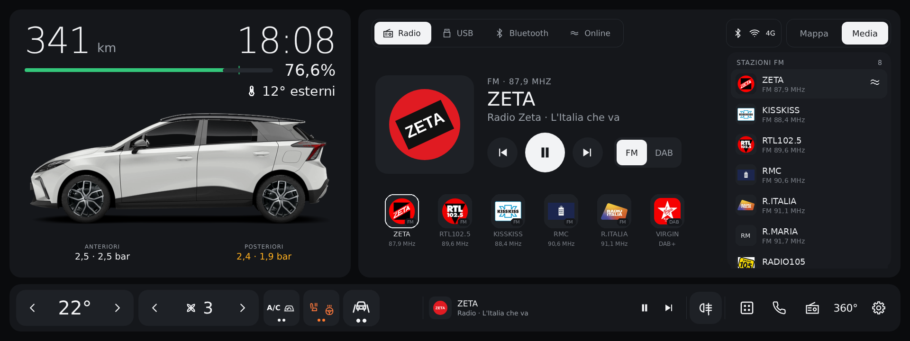

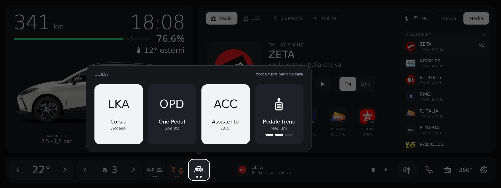
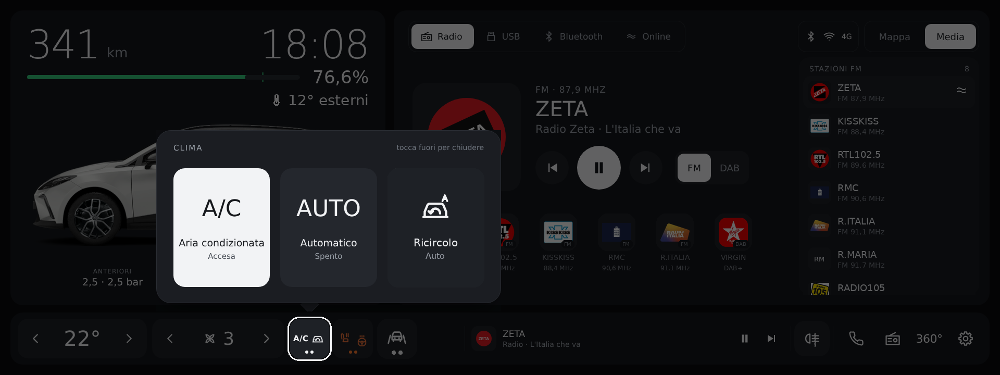
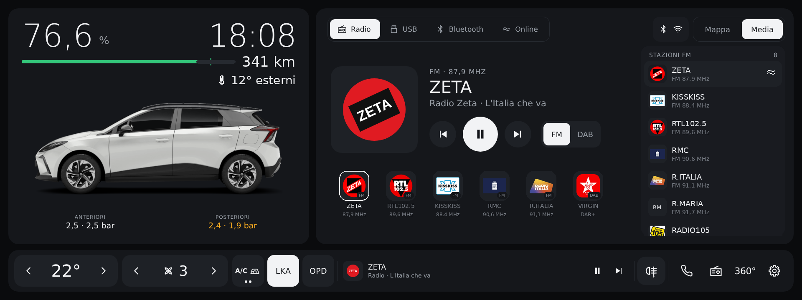


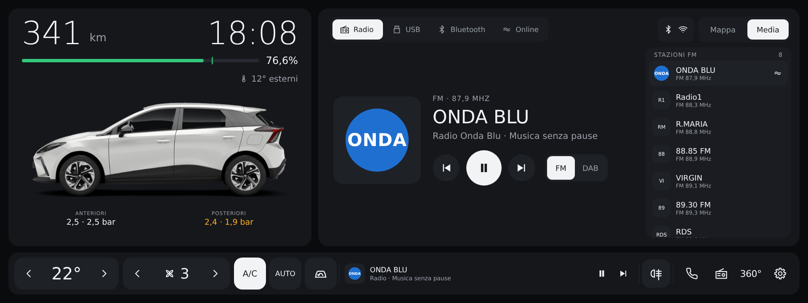
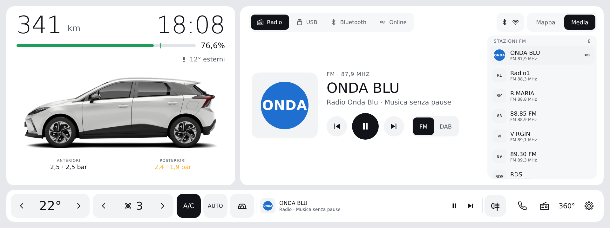
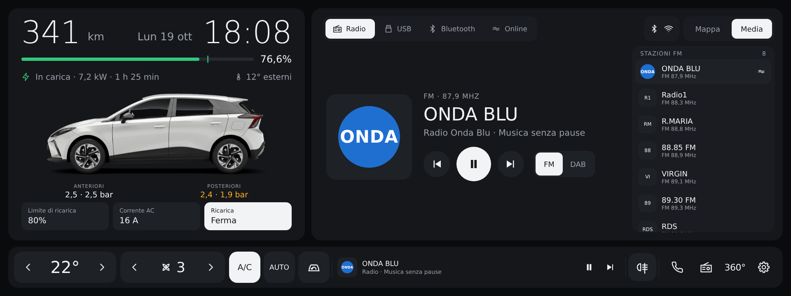
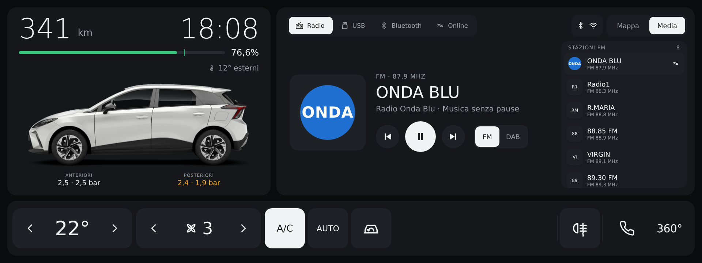
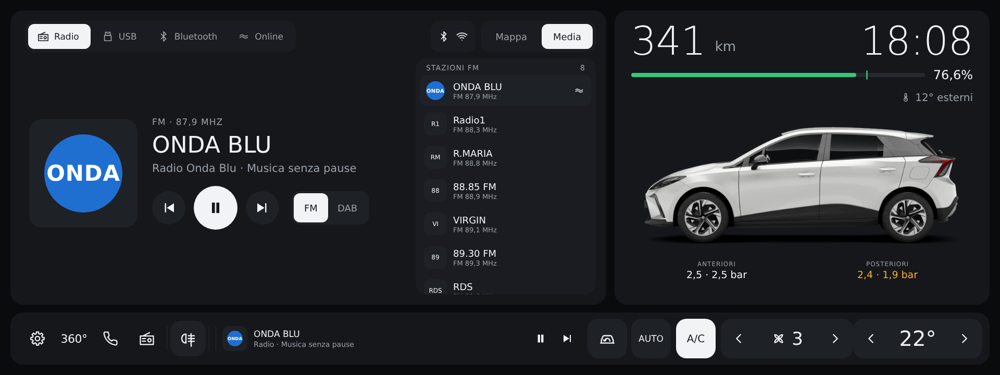

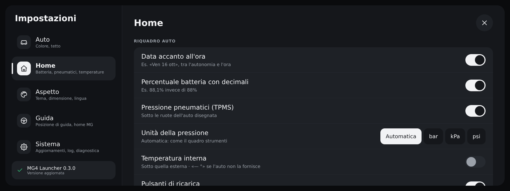
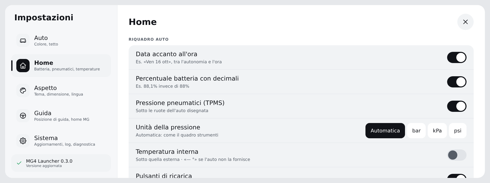

<sub>Anteprima della grafica 0.3.0 (home di notte e di giorno, con pulsanti di ricarica e data, barra grande, guida a destra; pagina App; impostazioni): i valori, le stazioni e i loghi sono di esempio · Preview of the 0.3.0 design (home at night and by day, with charging buttons and date, large bar, right-hand drive; Apps page; settings): values, stations and logos are examples.</sub>

---

## Video recensione / Video review

<a href="https://youtu.be/JKZ0N3Lr7FI"></a>

Guarda la [video recensione su YouTube](https://youtu.be/JKZ0N3Lr7FI) · Watch the [video review on YouTube](https://youtu.be/JKZ0N3Lr7FI).

---

## Sostieni il progetto / Support the project

MG4 Launcher è gratuito e lo resterà. Se ti è utile e ti va di contribuire alle ore passate a svilupparlo e a provarlo
in auto, puoi lasciare un'offerta. È del tutto **volontaria** e **non c'è un importo minimo**: puoi donare quello che
vuoi. Grazie anche solo per usarlo e per le segnalazioni.

MG4 Launcher is free and will stay free. If you find it useful and would like to support the hours spent building and
testing it in the car, you can leave a donation. It is entirely **voluntary** and **there is no minimum amount**: you
can give whatever you like. Thank you just for using it and reporting issues.

Anche solo **2 €** sono un aiuto prezioso per continuare a sviluppare e provare in auto le nuove versioni.

Even just **€2** is a great help to keep developing and testing new versions in the car.

<a href="https://paypal.me/ErnestoMicco?locale.x=it_IT&country.x=IT"></a>

## Quale versione installare? / Which version should I install?

C'è **un launcher diverso per ciascun software** dell'infotainment MG4. Non sono intercambiabili:
servizi dell'auto, radio, media e clima sono diversi, e con la versione sbagliata il launcher si apre ma non legge
nulla dall'auto ("Servizio veicolo non disponibile").

| Software dell'auto | Auto | Repository | File APK |
|---|---|---|---|
| **SWI68 SAIC 1.0+** | MG4 | [Mg4-Launcher-SWI68](https://github.com/ernestomicco2026-cell/Mg4-Launcher-SWI68) | `MG4Launcher-X.Y.Z.apk` |
| **SWI69 Color Radio** | MG4 MY23 | **questo repository** | `MG4Launcher-SWI69-X.Y.Z.apk` |
| **SWI132** | MG4 MY24 | [Mg4-Launcher-SWI132](https://github.com/ernestomicco2026-cell/Mg4-Launcher-SWI132) | `MG4Launcher-SWI132-X.Y.Z.apk` |
| **SWI133** | MG4 Luxury MY24 | [Mg4-Launcher-SWI133](https://github.com/ernestomicco2026-cell/Mg4-Launcher-SWI133) | `MG4Launcher-SWI133-X.Y.Z.apk` |

**Come sapere quale software hai:** con il computer collegato all'auto
`adb shell getprop ro.build.mt2712.version` → inizia con `SWI68-`, `SWI69-`, `SWI132-` o `SWI133-`: è il software della tua auto.
Se il launcher è già installato: impostazioni → riga **MG4 Launcher X.Y.Z · repository** sotto *Aggiornamenti*;
il nome del repository dice quale versione hai. Se nella *Diagnostica* compaiono `veicolo.bind = fallito` e
`media.usb.bind = fallito`, hai installato la versione SWI68 su un'auto SWI69 (o viceversa).

There is **a different launcher for each MG4 infotainment software**, and they are not interchangeable.
Check your software with `adb shell getprop ro.build.mt2712.version` (it starts with `SWI68-`, `SWI69-`, `SWI132-` or `SWI133-`) and
use the matching repository above.

---

## Italiano

Launcher in stile Tesla per l'infotainment della **MG4** con software **SWI69 Color Radio**
(EH32, Android Automotive 9, build `SWI69-29958-1100R45`).

**Compatibilità:** funziona **solo con il software SWI69 Color Radio**. La SWI69 Color Radio non è un aggiornamento
della SWI68: è un software diverso, con altri servizi dell'auto. Su SWI68 usa la [versione SWI68](https://github.com/ernestomicco2026-cell/Mg4-Launcher-SWI68).
Sostituisce la schermata home originale mantenendone le funzioni, con la stessa grafica della versione SWI68.

**Versioni dell'auto:** al momento la compatibilità è **garantita sulla MG4 standard MY23 con software R45**
(`SWI69-29958-1100R45`), dove il launcher è stato provato. Dato che usa gli stessi dati e servizi della **FICM**
originale (l'unità dell'infotainment), dovrebbe funzionare su **tutte le versioni con la radio Color Radio**.
Se lo provi su un'altra versione, le segnalazioni sono benvenute: con l'invio dei log attivo arrivano da sole.

### Cosa fa

- **Auto e batteria** (a sinistra): autonomia e **orologio** grandi, barra batteria con la percentuale accanto e la
  tacca del limite di ricarica, temperatura esterna; lo stato compare solo durante la ricarica o il V2L (tipo, potenza,
  tempo rimanente). Nelle impostazioni si attivano la **data** accanto all'ora, la percentuale con un decimale, la
  pressione degli pneumatici (TPMS) con l'unità a scelta (come il quadro, bar, kPa o psi) e i **pulsanti di ricarica** (limite di ricarica, corrente AC e avvia/ferma ricarica o V2L, con
  conferma). La tua MG4 ricolorabile con gli 8 colori della gamma, tetto nero opzionale.
  Tocca l'auto o V2L → app Energia. Tieni premuta l'auto → impostazioni del launcher.
- **Mappa / Media / CarPlay** (a destra):
  - **Mappa**: la SWI69 non ha un navigatore MG, si naviga con **CarPlay / Android Auto**. Senza guida una scheda
    mostra lo stato del telefono: collegato → pulsante **Apri CarPlay / Android Auto**; non collegato → ti ricorda
    di collegarlo. Durante la guida il pannello mostra le indicazioni del telefono.
  - **Media**: parte dalla sorgente in riproduzione, altrimenti dalla radio; in alto un pulsante per ogni sorgente
    (Radio, USB, Bluetooth, Online se disponibile, e CarPlay/Android Auto se il telefono è collegato);
    con più di 4 sorgenti quelle non selezionate mostrano solo l'icona.
    Per la radio: il **logo** della stazione nella copertina (il nome solo se il logo manca), **preferiti** e, a destra,
    **FM / DAB** con l'**elenco delle stazioni**: DAB dal servizio radio (**Aggiorna** per rileggerlo), FM dalla
    ricerca (**Cerca**) e dalle stazioni già ascoltate. Tocca una stazione per sintonizzarla, tienila premuta per
    aggiungerla o toglierla dai preferiti; tieni premuto un preferito per eliminarlo.
    **Loghi radio**: i tuoi nella cartella **MG4Launcher/loghi** (es. `MG4Launcher/loghi/NOME.png`, sulla memoria o su
    una chiavetta: hanno la priorità), quelli trasmessi dalle stazioni DAB e quelli scaricati quando c'è internet,
    salvati per sempre e riusati senza rete.
  - **CarPlay / Android Auto**: la scheda compare da sola quando colleghi il telefono.
  - In alto a destra, prima delle schede, una pillola con **Bluetooth** (pieno = telefono collegato, sbiadito = acceso)
    e **Wi-Fi** con 4 tacche di segnale (solo quando è collegato).
- **Barra in basso**, con comandi grandi da usare guidando: temperatura ‹ › (LO, 16…30, HI) e ventola ‹ ›
  (OFF / 1…11 / A = automatico; tocca il numero = app Clima, tieni premuto = accendi/spegni), pulsanti **A/C** e
  **AUTO** (acceso = colori invertiti), **ricircolo** a 3 stati (Interno / Esterno / Auto, solo se l'auto lo supporta), gruppo **Guida** (LKA, One Pedal, assistente Spento/ACC/TJA e pedale del freno, solo i comandi che l'auto ha), mini-player compatto,
  **retronebbia** (icona ambra da acceso; Automatico = nascosto se la barra di sistema mostra già la sua spia,
  oppure Mostra / Nascondi) e **fendinebbia anteriori** (verde, solo se l'auto li ha), Telefono, Radio, **360°**
  (telecamere), Impostazioni. Con la **barra grande** (opzione) i pulsanti del clima sono più grandi e il mini-player
  lascia il posto (la musica resta nel pannello Media).
- **App**: scorri la home verso sinistra per le app dell'auto e quelle che installi tu,
  con le icone tutte nello stesso stile; scorri verso destra per tornare. Con **Modifica** scegli quali app mostrare, anche quelle dell'auto.
  In fondo alle app dell'auto ci sono anche **Impostazioni Android** e **File Android** (solo se presenti sull'auto).
- **Dimensione comandi** (Normale / Grande / Molto grande): ingrandisce pulsanti, icone e testi dei pulsanti
  in proporzione, per usarli meglio guidando.
- **Guida a destra o a sinistra**: automatica dalla configurazione dell'auto o scelta nelle impostazioni; con la
  guida a destra la home si specchia, con auto e clima dal lato del guidatore. Sulle auto che mostrano sempre la
  spia luci del sistema in alto a sinistra, quell'angolo resta libero.
- **Impostazioni** (tieni premuta l'auto), divise in sezioni con un menu laterale: **Auto** (colore, tetto nero),
  **Home** (decimali, pressione pneumatici), **Aspetto** (tema, dimensione comandi, lingua),
  **Guida** (posizione di guida, home MG originale), **Sistema** (aggiornamenti, invio e salvataggio log, diagnostica).
  In fondo al menu sono sempre visibili la versione e, quando c'è, la nuova versione con **Installa**.
  Si aprono anche dall'ingranaggio in alto a destra nella pagina App.
- **Avvio all'accensione**: il launcher torna davanti da solo se il sistema apre la home MG; in più l'opzione
  **Premi Home da solo dopo l'accensione** (spento, 5, 10, 15, 20 o 30 secondi), una volta sola e solo se c'è la home MG.
- **Novità**: al primo avvio dopo un aggiornamento un popup elenca in breve le novità (una volta per versione).
- **Lingue**: italiano, inglese, spagnolo, tedesco, portoghese, francese, turco e polacco. Con **Come l'auto** (predefinita)
  il launcher usa la lingua di sistema e si aggiorna da solo quando la cambi nell'auto; altrimenti scegli una lingua
  nelle impostazioni. Per le lingue non tradotte usa l'inglese.
- **Schermo intero**: barra di stato e dock MG nascosti (trascina dal bordo per richiamarli).
- **Aggiornamenti**: le nuove versioni si scaricano e si installano dalle impostazioni, senza computer. Quando ne
  esce una, compare in basso a destra un piccolo avviso con **Aggiorna** / **Più tardi** (sparisce da solo; "Più tardi"
  lo rimanda di un giorno).
- **Musica che riprende da sola**: se una notifica del telefono fa passare la musica Bluetooth (o USB / online)
  alla radio, il launcher rimette in riproduzione la tua musica dopo qualche secondo. Non interviene se la radio
  l'hai scelta tu.
- **Invio dei log**: il launcher invia in automatico la diagnostica allo sviluppatore
  (all'avvio, ogni 30 minuti e con **Salva log**), per poter correggere i problemi senza dover raccogliere i file a mano.
  Contiene solo versione, valori letti dai servizi dell'auto ed errori: niente posizione, telaio o dati del telefono.
  Si disattiva nelle impostazioni (**Invio log**).

### Installazione

Solo per infotainment **SWI69 Color Radio**. Scarica l'APK dalla cartella [`releases/`](releases/).
Ci sono due modi per installarlo: da chiavetta USB, se riesci ad aprire un file manager sull'auto, oppure con adb da computer.

#### Metodo 1 — Da chiavetta USB (senza computer)

Serve poter aprire un file manager sull'infotainment.

1. Copia `MG4Launcher-SWI69-0.3.11.apk` su una chiavetta USB formattata **FAT32** o **exFAT**.
2. Inserisci la chiavetta nell'auto, apri il file manager e tocca l'APK.
3. Se Android avvisa che non può installare app da questa fonte: tocca **Impostazioni**, attiva
   **Consenti da questa fonte** per il file manager e torna indietro.
4. Tocca **Installa**.
5. Premi il tasto **Home**: Android chiede quale home usare. Scegli **MG4 Launcher** e poi **Sempre**.

Se **Impostazioni** non apre nulla o l'installazione dà errore, usa il metodo 2
(e, se puoi, segnala il messaggio d'errore).

#### Metodo 2 — Con adb da computer

Serve un computer con [adb](https://developer.android.com/tools/releases/platform-tools) collegato all'auto.
Il firmware MG può bloccare l'installazione normale delle app: l'opzione `-f` la permette.

1. Installa:
   ```bash
   adb install -r -f MG4Launcher-SWI69-0.3.11.apk
   ```
2. Rendilo la home predefinita:
   ```bash
   adb shell cmd package set-home-activity com.mg4.launcher/.MainActivity
   ```
   In alternativa premi il tasto Home: Android chiede quale home usare.

> **Se premendo Home Android non chiede quale home usare** (su alcune SWI69 il tasto apre direttamente la home
> MG): non serve fare altro, il launcher ora si sostituisce da solo alla home MG ogni volta che compare.
> Se hai un'app che rimappa i tasti (es. **MG4 Control**), controlla che il tasto Home non sia assegnato alla
> home MG.

Con entrambi i metodi il launcher parte poi da solo all'accensione dell'auto, come la home originale,
e gli aggiornamenti successivi si fanno dalle impostazioni del launcher, senza chiavetta né computer.

### Aggiornamenti

Impostazioni del launcher → **Sistema** → **Aggiornamenti** → **Controlla**.
Se c'è una versione più nuova compare **Installa** (anche in fondo al menu delle impostazioni): il launcher la installa da solo e si riavvia.
Serve che l'auto sia collegata a internet (connettività dell'auto o hotspot del telefono).
Gli aggiornamenti arrivano solo da questo repository: una versione SWI68 non viene mai proposta.
Chi ha una versione precedente alla 0.1.3 deve installare una volta a mano una versione più recente (chiavetta o adb).
Si possono installare anche da computer, con lo stesso comando dell'installazione.

### Tornare alla home MG originale

Dal launcher: impostazioni → **Apri la home originale MG**. Per renderla di nuovo quella predefinita:

```bash
adb shell cmd package set-home-activity com.saicmotor.launcher/.view.MainActivity
```

Per rimuovere del tutto il launcher, anche senza computer (dalla 0.3.3): impostazioni → **Disinstalla MG4 Launcher**.
Rimette la home MG originale e toglie il launcher dall'auto. Da computer: `adb uninstall com.mg4.launcher`.
L'app originale non viene mai modificata.

### Comandi utili

```bash
# riavviare il launcher senza spegnere l'auto
adb shell am force-stop com.mg4.launcher
adb shell am start -n com.mg4.launcher/.MainActivity

# vedere i valori letti dall'auto (Ctrl+C per fermare)
adb logcat -s MG4L MG4L.Link

# scaricare la diagnostica salvata dal launcher (aggiornata ogni 15 s)
adb pull /sdcard/Android/data/com.mg4.launcher/files/diagnostica.txt
```

### Segnalare un problema

Nelle impostazioni la colonna **Diagnostica servizi auto** mostra i valori letti dall'auto e gli errori recenti. Uno screenshot di quella colonna
o il file `diagnostica.txt` bastano per capire cosa succede.

Con **Salva log** (in alto nella colonna Diagnostica) il launcher scrive un log completo — valori, errori, eventi
recenti e logcat del launcher — in `Android/data/com.mg4.launcher/files/mg4-launcher-log-….txt`.
Se è inserita una chiavetta USB il file finisce anche lì, nella stessa cartella.


### Versioni

#### 0.3.11
- **Riavvio del dongle CarPlay/AA**: non resetta più i telefoni collegati col cavo (iPhone, Android Auto). Interviene
  solo sui dongle wireless riconosciuti dal nome (es. smartlinkBox, OKBox, AAWireless, SmartBox, AutoKit) o già visti
  in una sessione con il nome del dongle; i dongle CarPlay che si presentano come iPhone vengono riconosciuti dopo la
  prima sessione. Con un telefono collegato la porta USB non si tocca. Nel log c'è il motivo di ogni esclusione.
- **Velocità**: il launcher si concede il permesso della velocità; se l'auto non lo concede non la rilegge più e lo
  scrive una sola volta nel log.
- **Certificati**: aggiunte le radici USERTrust ECC e Sectigo R46/E46 (oltre a USERTrust RSA) per loghi, aggiornamenti
  e invio dei log; nel log c'è la causa precisa degli errori di connessione.
- **Prima configurazione di Android**: se la home risulta la procedura di prima configurazione, il launcher la
  riconosce, scrive nel log lo stato della configurazione e non la tratta come la home MG.
- **Log**: nessun invio da telefoni, emulatori o firmware non riconosciuti.

#### 0.3.10
- **Schermata App**: dimensione separata per icone e testo (più grandi), da scegliere nelle impostazioni.
- **Dongle**: il log registra se il dongle ricompare dopo il reset.
- **Certificati**: aggiunta la radice di sicurezza USERTrust RSA (Sectigo) per le connessioni a GitHub.

#### 0.3.9
- **Avvio sicuro**: il launcher diventa la home del sistema e parte sempre all'accensione e col tasto Home. Si disattiva
  solo la schermata principale della home MG (il resto dell'app MG resta attivo), che torna da sola con l'officina,
  l'interruttore spento, "Disinstalla", l'apertura apposta della home MG o se il launcher si chiude 3 volte in 3
  minuti. Si spegne in Impostazioni › Sistema.
- **Avvio più affidabile**: la home MG aperta apposta non blocca più l'accensione successiva; se la home MG non
  compare il launcher si apre lo stesso; se un'altra app gli toglie l'accessibilità se la rimette; avviso se è
  installato un altro launcher.
- **Loghi radio**: Australia e Sud America (pacchetti scaricabili), e il paese si può scrivere a mano (pulsante Codice).
- **CarPlay / Android Auto**: si apre con un solo tocco e ha la sua icona nella barra finché il telefono è collegato.
- **Impostazioni**: tolto lo spazio vuoto tra Riquadro auto e Barra in basso.

#### 0.3.8
- **Gruppo Guida** nella barra (icona dell'auto tra le linee della corsia): LKA, One Pedal, **assistente di guida**
  (Spento / ACC / TJA) e **sensibilità del pedale del freno** (Comfort / Medium / Sport) in un unico riquadro, solo i
  comandi che l'auto ha. Assistente e pedale si cambiano solo ad auto ferma.
- **Ricircolo a 3 stati** come l'app clima originale: Interno → Esterno → Auto, con l'icona che cambia.
- **Temperatura interna tolta**: l'auto non la manda allo schermo (il valore "ambient" era la temperatura esterna).
  Nelle impostazioni c'è la spiegazione.
- **Pagina App**: con **Modifica** si possono nascondere anche le app dell'auto, non solo quelle installate.
- **Tasto Home**: ora riporta sempre al launcher. Nel firmware la home MG ha la precedenza e Android la sceglieva
  sempre, anche con il launcher come home predefinita (succedeva su quasi tutte le auto).
- **Temperatura esterna**: niente più 0° falso quando l'auto non ha ancora il dato.

#### 0.3.7
- **Ventola su OFF**: l'auto non accetta la ventola a 0 e dopo un attimo la rimetteva a 1. Come nell'app originale,
  la ventola va da 1 in su e OFF ora spegne davvero il clima.

#### 0.3.6
- **Cerchi a scelta** nelle impostazioni (Auto, sotto il colore): 16″ copricerchi neri, 17″ Aero bicolore (di serie),
  18″ Luxury / Trophy e 18″ XPOWER. Si vedono sull'auto della home e nell'anteprima.
- **Temperatura esterna più affidabile**: il launcher controlla il flag di validità del firmware, come il pannello
  originale, e non mostra più valori non validi come -40°.
- **Temperatura interna nascosta**: l'auto non la fornisce con le proprietà standard. Quella chiamata "ambient" è la
  temperatura esterna, che prima con l'opzione accesa si vedeva come interna. Il launcher ora la cerca tra tutte le
  proprietà dell'auto e scrive nei log i valori trovati, per poterla aggiungere in una prossima versione.
- **Dongle CarPlay / Android Auto**: riconosciuti anche quelli che si presentano come un iPhone o un telefono Android
  (es. SmartBox). Se dopo il ritardo non parte nessuna sessione, il dispositivo viene riavviato.
- **Popup delle novità a ogni versione**, con le novità di quella versione.

#### 0.3.5
- **Tasto del clima**: se è installato [MG4 Clima](https://github.com/ernestomicco2026-cell/HVAC-Clima-MG4) apre
  direttamente quello (la nuova schermata del clima in stile Tesla), senza far vedere per un istante il clima originale.
  Senza MG4 Clima tutto resta come prima.

#### 0.3.4
- **La home si apre da sola all'accensione**: dai log di questa versione la home MG arriva spesso *dopo* il launcher
  (da 29 a 81 secondi dopo), quando il controllo dell'avvio era già finito. Ora, finché la home MG non è comparsa, il launcher la
  aspetta (al massimo 3 minuti) e poi torna davanti; anche *Premi Home da solo* riprova invece di fare un solo
  tentativo. Retrocamera, CarPlay/Android Auto, chiamate e la home MG aperta apposta restano come prima.
- **Niente più crash all'accensione**: prima dello sblocco del sistema le impostazioni del launcher non sono leggibili;
  ora il launcher aspetta lo sblocco invece di chiudersi a ogni avvio.
- **Percentuale batteria in grande** (Impostazioni → Home): inverte km e percentuale.

#### 0.3.3
Correzioni dalle prove sulla SWI69 (firmware EH32 LL R45), fatte sui servizi originali di questa versione.
- **Pulsante 360°/telecamere**: il launcher legge la configurazione telecamere dell'auto, come la home MG originale.
  Se l'auto non ha telecamere il pulsante non compare; se le ha, apre la stessa app della home originale
  (telecamera posteriore, AVM o vista 360°).
- **Passaggio dalla radio al Bluetooth** corretto: il launcher chiede il cambio di sorgente all'app Media dell'auto con
  lo stesso comando della home originale, invece di prendere l'audio da solo. Niente più play/pausa che si alternano.
- **Disinstallazione dall'auto**: impostazioni → *Disinstalla MG4 Launcher*. Rimette la home MG originale come
  predefinita e toglie il launcher, senza computer.
- **Temperatura interna/esterna e percentuale della batteria più grandi** e più chiare, leggibili durante la guida.

#### 0.3.2
Stesse novità della versione SWI68 0.8.2 e 0.8.3, con i servizi della SWI69.
- **Pulsanti raggruppati** nella barra: **Clima** (A/C, AUTO, ricircolo). Un tocco apre sopra la barra un riquadro con le
  caselle grandi (si chiude toccando fuori o da solo dopo pochi secondi); pressione lunga: A/C. Funzionano anche con la
  barra grande, che ora ha di nuovo il mini player. Si possono spegnere nelle impostazioni (*Pulsanti raggruppati*).
  Il gruppo **Comfort** (sedili e volante riscaldati) non compare: sulla SWI69 questi comandi non sono usati dalle app
  originali dell'auto.
- **LKA** (mantenimento corsia) e **OPD** (One Pedal Drive) nella barra, con lo stato reale dell'auto e gli stessi
  comandi dell'app Impostazioni veicolo: solo comando manuale, nessun automatismo all'avvio. Compaiono solo se l'auto li
  ha; si possono nascondere.
- **Pacchetti dei loghi radio per paese**, per FM e DAB: si scaricano una volta (con controllo dell'integrità) e poi
  funzionano senza internet; paese automatico (dal **fuso orario** dell'auto, poi dalla lingua del launcher, confermato
  dalle stazioni DAB) o scelta di uno o più paesi, *Aggiorna* ed *Elimina* nelle impostazioni, installazione da chiavetta.
  I nomi DAB con `#` davanti e le varianti di una stazione (es. RTL 102.5) trovano il logo.
- **Nome delle stazioni sempre visibile**: nella lista delle stazioni e nei preferiti ci sono sempre logo, nome e
  frequenza (o DAB+). Solo nella copertina grande il logo resta da solo, con il nome accanto.
- **Riavvio del dongle CarPlay/Android Auto** che non si collega: solo con un dongle wireless riconosciuto (mai con un
  telefono via cavo o una chiavetta), al massimo 2 tentativi per accensione, mai durante una chiamata. Attesa
  regolabile e pulsante *Riavvia CarPlay/AA* nelle impostazioni.
- Launcher più leggero: log senza le righe di sistema ripetitive, tolti testi e icone non più usati, immagini dell'auto
  più leggere (identiche), i loghi non sono più dentro l'app.

#### 0.3.1

**Correzioni**
- **CarPlay / Android Auto**: indietro, play/pausa e avanti (pannello Media e mini-player) ora funzionano anche con gli
  adattatori CarPlay wireless (es. AutoKit). Come la home originale, il launcher manda sempre i tasti del servizio
  CarPlay/Android Auto (premuto e rilasciato); i comandi di Android si usano solo se quel servizio non è collegato.
- Play/pausa di CarPlay è un tasto unico che commuta: si preme solo se lo stato è diverso da quello voluto, quindi
  scegliendo la sorgente CarPlay la musica non va più in pausa.
- Quando CarPlay o Android Auto iniziano a suonare diventano la sorgente attiva, e i tasti comandano il telefono.
- Diagnostica: ogni tasto mandato con la risposta del servizio e lo stato di riproduzione di CarPlay.

#### 0.3.0

Nuova generazione: stessa grafica e stesse funzioni della versione SWI68 0.8.0, con i servizi della SWI69.

**Novità**
- **Pulsanti di ricarica** (opzione, al posto dei riquadri sotto l'auto): limite di ricarica (40…100 %), corrente AC
  (6 A, 8 A, 16 A, Max) e avvia/ferma, che riconosce da solo se l'auto è collegata per caricare o per il V2L. Usano gli
  stessi comandi della Gestione ricarica dell'app Energia, solo con i valori ammessi dall'auto, e chiedono conferma
  prima di avviare o fermare. Spenti, lo spazio va all'auto.
- **Ricircolo** nella barra del clima, con lo stesso comando della home originale (si nasconde se l'auto non lo supporta).
- **Barra grande** come opzione: pulsanti del clima più grandi, il mini-player lascia il posto.
- **Data** accanto all'ora (opzione, spenta di default), nella lingua scelta.
- Lo stato compare solo durante la ricarica o il V2L (tipo, potenza, tempo rimanente): tolti la scritta "Pronta" e
  il consumo medio (l'auto restituiva sempre un valore non valido).
- **Unità della pressione** degli pneumatici: Automatica (come il quadro), bar, kPa o psi.
- **Loghi radio**: cartella **MG4Launcher/loghi** per i tuoi (ha la priorità), loghi scaricati salvati per sempre e
  riusati senza internet, il logo al posto del nome nella copertina; spazio per un pacchetto di loghi integrato.
- **Retronebbia**: Automatico (si nasconde se la barra di sistema mostra già la sua spia), Mostra o Nascondi.
- Pulsante **360°** nella barra, che apre le telecamere come la home originale.
- **Premi Home da solo dopo l'accensione** (spento, 5, 10, 15, 20 o 30 secondi): una volta sola, solo se c'è la home MG.
- Popup **Novità** al primo avvio dopo un aggiornamento.
- **Lingua polacca**.
- Impostazioni come la SWI68: interruttore **Usa come home predefinita** e **modalità officina** (1, 3 o 7 giorni con
  la home MG), avviso aggiornamenti in alto attivabile.

**Correzioni**
- **Cambio Radio ↔ Bluetooth**: prima di avviare la musica il launcher chiede all'auto la sorgente audio Bluetooth,
  come l'app Media originale (prima l'auto restava sulla radio). Dopo 3 secondi l'esito va nei log; se non è partito
  si apre la pagina Bluetooth dell'app Media. Con CarPlay collegato un avviso spiega che l'audio dell'iPhone passa da
  CarPlay.
- **CarPlay / Android Auto** come sorgente attiva: avanti e play/pausa comandano il telefono.
- Se è installata su un'auto **SWI68** (o su un dispositivo che non è una MG4 SWI69) mostra un avviso con il link alla
  versione giusta e non tenta collegamenti.
- Se un'app originale manca, si apre la sua schermata principale; se manca del tutto il pulsante si disattiva
  (scritto una sola volta nei log, non a ogni tocco).
- Temperatura interna: se l'auto non la fornisce non si rilegge più e l'opzione si nasconde.
- Valori vuoti del gestore batteria: non generano più un errore ogni 2 secondi.
- Loghi radio senza rete: tentativi in pausa invece di migliaia di errori.
- Invio log: un file già presente non resta più in coda.
- Home con dimensioni fisse dal primo disegno: l'auto non si rimpicciolisce più quando arriva la pressione gomme.
- Le schede Mappa e CarPlay dicono chiaramente che sono scorciatoie; durante la guida con CarPlay / Android Auto il
  riquadro mostra la prossima manovra.
- Le impostazioni della 0.2.x (lingua, decimali, TPMS, temperatura interna) restano come le avevi.

#### 0.2.7
- **Il launcher parte all'accensione**: se all'avvio il sistema apre la home MG originale al posto del launcher, il
  launcher torna in primo piano da solo (al massimo 3 volte e solo nel primo minuto dopo l'accensione). Non interviene
  se in primo piano c'è un'altra app (retrocamera, CarPlay, Android Auto, chiamata, avvisi di sistema) né se hai aperto
  apposta la home MG dalle impostazioni. Se sulla tua auto il problema non c'è, il controllo non fa nulla.
- **Avvio più rapido**: il launcher attiva da solo un piccolo servizio di accessibilità ("MG4 Launcher · avvio
  rapido") che Android collega subito all'avvio del sistema, prima del segnale di avvio completato (che arriva circa
  30 secondi dopo l'accensione). Così il launcher torna davanti appena compare la home MG, invece di aspettare.
  Il servizio vede solo quale app è in primo piano, nessun contenuto, e lavora solo nel primo minuto dopo
  l'accensione o il risveglio dello schermo; gli altri servizi di accessibilità già attivi restano com'erano.
  Il controllo della prima versione resta come riserva se il servizio non è attivo.
- **Home MG aperta dal tasto Home**: su alcune SWI69 il tasto Home (o un'app che rimappa i tasti, come MG4 Control)
  apre la home MG per nome, ignorando la home predefinita. Ora, con il launcher impostato come home, il servizio
  sostituisce la home MG ogni volta che compare, non solo all'accensione. Non interviene se l'hai aperta apposta
  dalle impostazioni del launcher né se davanti c'è un'altra app; se la home MG ricompare più di 3 volte in
  10 secondi si ferma per 2 minuti. Senza il servizio attivo resta solo il controllo all'accensione.
- All'avvio il launcher riconferma di essere la home predefinita, nel caso un aggiornamento di sistema l'abbia azzerata.
- **Impostazioni Android** e **File Android** in fondo alle app dell'auto (pagina App), con nomi e icone diversi da
  quelli MG; ciascuna compare solo se l'auto ha davvero quell'app. Le Impostazioni e i File MG restano come prima.
- Pagina App: il titolo della sezione è tornato "AUTO" (nella 0.2.6 compariva "Auto").
- Diagnostica: nuove voci per l'avvio (accensione, app in primo piano, ripresa della home, home predefinita, tempi
  dell'avvio, servizio di accessibilità, home MG sostituita dal tasto Home, home predefinita, app che rimappano i
  tasti) e per le app di sistema.

#### 0.2.6
- **Nuove impostazioni**: menu delle sezioni a sinistra (Auto, Home, Aspetto, Guida, Sistema) e contenuto a destra,
  senza scorrere. Righe grandi con una breve spiegazione, interruttori e pulsanti che seguono "Dimensione comandi",
  colori del tema giorno/notte. Con la guida a destra il menu passa a destra.
- **Versione sempre visibile** in fondo al menu, con **Installa** quando è disponibile una nuova versione.
- **Musica Bluetooth che passava alla radio dopo una notifica**: se la radio parte da sola subito dopo la pausa
  della musica (Bluetooth, USB o online), dopo circa 2,5 secondi il launcher rimette in play la sorgente che stavi
  ascoltando. Non interviene se la radio l'hai scelta tu (sorgente, banda, stazione) e al massimo 2 volte al minuto.
- **Temperatura interna** attivabile dalle impostazioni (sezione Home), spenta di serie. Quando è accesa e l'auto non
  fornisce il dato compare "— °", mai 0°.
- Diagnostica: nuove voci per la ripresa automatica della musica.

#### 0.2.5
- **Dimensione comandi** nelle impostazioni: Normale, Grande (×1,15) e Molto grande (×1,3), solo per i comandi toccabili.
- **Posizione di guida** (come l'auto, sinistra o destra): con la guida a destra la home si specchia.
- Angolo in alto a sinistra libero sulle auto che mostrano sempre la spia luci del sistema.
- Musica online: il pulsante compare solo sulle auto dove la funzione è attiva (prima toccandolo spariva).

#### 0.2.4
- Temperatura interna nascosta quando l'auto non la fornisce (prima poteva comparire "0° interni").
- Pressione pneumatici: se il servizio dell'auto restituisce 0, il launcher prova a leggerla dal sistema auto di Android
  (con un nuovo permesso di sola lettura).

#### 0.2.3
- **Percentuale della batteria con un decimale** (es. 88,1%), attivabile nelle impostazioni.
- **Pressione degli pneumatici (TPMS)** sotto le ruote dell'auto disegnata (anteriori sotto la ruota davanti, posteriori
  sotto quella dietro, nell'unità scelta sul quadro; in ambra se l'auto segnala un problema), attivabile nelle impostazioni.
- **Temperatura interna** sotto quella esterna, quando l'auto la fornisce.

#### 0.2.2
- Nome corretto del software (**SWI69**) e del repository (**Mg4-Launcher-SWI69**). Se nelle impostazioni era salvato
  il vecchio repository Mg4-Launcher-SW169, il launcher passa da solo al nuovo per gli aggiornamenti.

#### 0.2.1
- Nome corretto del software: **SWI69** (non SW169) nel repository, nei file APK e nella cartella dei log.

#### 0.2.0
- **Orologio** nel riquadro batteria, grande quanto l'autonomia; percentuale accanto alla barra della batteria.
- **Clima più grande** e più facile da usare guidando: temperatura e ventola con pulsanti da 68 dp su fondo chip,
  nuovi pulsanti **A/C** e **AUTO**; barra in basso alta 100 dp e mini-player più compatto.
- **Fendinebbia**: retronebbia (e anteriori, se presenti) direttamente dalla barra in basso.
- **Indicatori Bluetooth e Wi-Fi** (4 tacche) in alto a destra.
- Con più di 4 sorgenti media, solo l'icona per quelle non selezionate.

#### 0.1.4
- **Invio automatico dei log** nel repository privato dello sviluppatore: all'avvio, ogni 30 minuti e con **Salva log**;
  senza rete restano in coda. Interruttore e stato nelle impostazioni (**Invio log**).
- **Avviso discreto di nuova versione**: piccola scheda in basso a destra con **Aggiorna** / **Più tardi**,
  controllo ogni 6 ore; sparisce da sola e "Più tardi" la rimanda di 24 ore.

#### 0.1.3
- Aggiornamenti più affidabili: niente più errore 403 durante il controllo.

#### 0.1.2
- Riquadro navigazione ridisegnato: scheda centrale con lo stato del telefono e pulsante per aprire CarPlay /
  Android Auto (o l'invito a collegare il telefono).
- Radio: elenco delle stazioni accanto ai comandi (DAB dal servizio radio, FM dalla ricerca e da quelle ascoltate),
  con FM / DAB in testa all'elenco, ★ per i preferiti, **Cerca** / **Aggiorna**; layout adattato allo schermo.
- **Multilingua**: italiano, inglese, spagnolo, tedesco, portoghese, francese e turco; scelta nelle impostazioni,
  con **Come l'auto** che segue la lingua di sistema.

#### 0.1.1
- Tolto il pulsante Telecamere: le MG4 con SWI69 non hanno la telecamera a 360°.
- Navigatore solo da CarPlay / Android Auto: tolti i pulsanti Casa / Lavoro, il pulsante "MG" e la scelta del
  navigatore predefinito nelle impostazioni; il launcher non si collega più al servizio di navigazione MG.

#### 0.1.0
- Prima versione per **SWI69 Color Radio**, con la grafica e le correzioni della versione SWI68 0.4.1.
- Servizi dell'auto riscritti per la SWI69: batteria, ricarica, V2L e clima dal servizio `caradapter`;
  limite di ricarica, potenza e consumo dal CarService (come l'app Energia).
- Clima **16–30 °C** (LO / HI agli estremi), come sulla MG4 EU con SWI69.
- Media con le sessioni standard di Android (USB, Bluetooth, online, radio); bande DAB / FM.
- Preferiti radio gestiti dal launcher (l'app Radio SWI69 non li rende leggibili alle altre app).
- V2L e auto aprono l'app Energia; pulsante Telecamere come la home originale SWI69.
- Pulsante "MG" del navigatore solo se l'auto ha un navigatore MG.
- Aggiornamenti solo da questo repository.

### Compilare

Il launcher si compila con lo script `build.sh` incluso, senza Gradle; alcuni strumenti Android necessari non sono
nel repository e vanno aggiunti in `tools/`. La versione è in `version.properties`, i testi delle 7 lingue in
`tools/strings.py`. Gli APK pubblicati sono nella cartella `releases/`.

### Come comunica con l'auto

Il launcher usa gli stessi servizi di sistema della home originale **SWI69 Color Radio**: veicolo e batteria, clima,
luci, media, radio e CarPlay / Android Auto. Legge i dati e invia all'auto solo i comandi che tocchi tu (clima,
fendinebbia, sorgenti e brani); non modifica nulla del sistema.

La mappa di CarPlay / Android Auto non può essere mostrata dentro il launcher:
il pannello Mappa mostra le indicazioni del telefono e apre CarPlay / Android Auto a schermo intero.

### Note

- L'immagine dell'auto deriva da una foto ufficiale MG; marchi e immagini appartengono ai rispettivi proprietari.
- I loghi delle stazioni FM vengono da [radio-browser.info](https://www.radio-browser.info), database pubblico e gratuito.

---

## English

Tesla-style launcher for the **MG4** infotainment system running **SWI69 Color Radio** software
(EH32, Android Automotive 9, build `SWI69-29958-1100R45`).

**Compatibility:** works **only with SWI69 Color Radio**. SWI69 Color Radio is not an update of SWI68: it is different
software with different car services. On SWI68 use the [SWI68 version](https://github.com/ernestomicco2026-cell/Mg4-Launcher-SWI68).
It replaces the original home screen, keeping its features, with the same design as the SWI68 version.

**Car versions:** compatibility is currently **verified on the MG4 standard MY23 with R45 software**
(`SWI69-29958-1100R45`). Since it uses the same data and services as the original **FICM** (the infotainment unit),
it should work on **every version with the Color Radio**. Reports from other versions are welcome.

### Features

- **Car and battery** (left): large range and **clock**, battery bar with the percentage next to it and a
  charge-limit mark, outside temperature; the status shows only while charging or using V2L (type, power, time left).
  The settings turn on the **date** next to the time, the percentage with one decimal, the tyre pressure (TPMS) with a
  choice of unit (as on the cluster, bar, kPa or psi) and the
  **charging buttons** (charge limit, AC current and start/stop charging or V2L, with confirmation). Your MG4, recolourable with the 8 factory colours, optional black roof.
  Tap the car or V2L → Energy app. Long-press the car → launcher settings.
- **Map / Media / CarPlay** (right):
  - **Map**: SWI69 has no MG navigator, navigation is done with **CarPlay / Android Auto**. When not guiding, a card
    shows the phone status with an **Open CarPlay / Android Auto** button (or a reminder to connect the phone);
    while guiding, the panel shows the phone's directions.
  - **Media**: starts on the source that is playing, otherwise the radio; one button per source at the top
    (Radio, USB, Bluetooth, Online when available, plus CarPlay/Android Auto when a phone is connected);
    with more than 4 sources the unselected ones show only their icon.
    Radio: the station **logo** on the cover (the name only when there is no logo), **favourites** and, on the right,
    **FM / DAB** with the **station list** (DAB from the radio service, FM from a scan and from stations you have
    listened to). Tap a station to tune in, long-press it to add/remove it from favourites.
    **Radio logos**: your own in the **MG4Launcher/loghi** folder (e.g. `MG4Launcher/loghi/NAME.png`, on the storage or
    a USB stick: they take priority), the ones sent by DAB stations and the ones downloaded when online, kept for good
    and reused offline.
  - **CarPlay / Android Auto**: the tab appears by itself when you connect a phone.
  - Top right, before the tabs, a pill with **Bluetooth** (solid = phone connected, faded = on) and **Wi-Fi** with
    4 signal bars (only when connected).
- **Bottom bar**, with large controls for use while driving: temperature ‹ › (LO, 16…30, HI) and fan ‹ ›
  (OFF / 1…11 / A = auto; tap the number = Climate app, long-press = climate on/off), **A/C** and **AUTO** buttons
  (on = inverted colours), 3-state **recirculation** (Inside / Outside / Auto, only if the car supports it), **Driving** group (LKA, One Pedal, assistant Off/ACC/TJA and brake pedal, only the controls the car has), compact mini player, **rear fog light**
  (amber when on; Automatic = hidden if the system bar already shows its indicator, or Show / Hide) and **front fog
  lights** (green, only if fitted), Phone, Radio, **360°** (cameras), Settings. With the **large bar** (option) the
  climate buttons are bigger and the mini player makes room (music stays in the Media panel).
- **Apps**: swipe the home screen left for the car's apps and the ones you install; swipe right to go back.
  Use **Modifica** (Edit) to choose which apps to show, car apps included. At the end of the car's apps there are also
  **Android settings** and **Android files** (only if present on the car).
- **Control size** (Normal / Large / Extra large): scales buttons, icons and button labels proportionally,
  for easier use while driving.
- **Right- or left-hand drive**: automatic from the car configuration or chosen in the settings; with right-hand
  drive the home screen is mirrored, with car and climate on the driver's side. On cars that always show the
  system light indicator at the top left, that corner is kept free.
- **Settings** (long-press the car), split into sections with a side menu: **Car** (colour, black roof),
  **Home** (decimals, tyre pressure), **Appearance** (theme, control size, language),
  **Driving** (driving side, original MG home), **System** (updates, log upload and saving, diagnostics).
  The version, and a new version with **Install** when available, are always shown at the bottom of the menu. Also available from the gear at the top right of the Apps page.
- **Full screen**: status bar and MG dock hidden (swipe from the edge to bring them back).
- **Updates**: new versions download and install from the settings, no computer needed. When one is out, a small
  notice with **Update** / **Later** appears at the bottom right (it hides by itself; "Later" waits a day).
- **Music that resumes by itself**: if a phone notification makes the Bluetooth (or USB / online) music switch to
  the radio, the launcher resumes your music after a few seconds. It does nothing if you chose the radio yourself.
- **Log upload**: the launcher automatically sends its diagnostics to the developer (at start,
  every 30 minutes and with **Save log**). Only version, values read from the car services and errors: no location,
  VIN or phone data. It can be turned off in the settings (**Log upload**).

- **Start at power-on**: the launcher comes back to the front by itself if the system opens the MG home; plus the
  **Press Home automatically after power-on** option (off, 5, 10, 15, 20 or 30 seconds), once only and only over the MG home.
- **What's new**: on the first start after an update a popup briefly lists what's new (once per version).

**Languages:** Italian, English, Spanish, German, Portuguese, French, Turkish and Polish. **Same as car** (default) follows
the system language and updates by itself when you change it in the car; or pick a language in the settings.
Other system languages fall back to English.

### Installation

Only for **SWI69 Color Radio** infotainment. Download the APK from the [`releases/`](releases/) folder.
There are two ways to install it: from a USB stick, if you can open a file manager on the car, or with adb from a computer.

#### Method 1 — From a USB stick (no computer)

You need to be able to open a file manager on the infotainment.

1. Copy `MG4Launcher-SWI69-0.3.11.apk` to a USB stick formatted as **FAT32** or **exFAT**.
2. Plug it into the car, open the file manager and tap the APK.
3. If Android says it cannot install apps from this source: tap **Settings**, enable
   **Allow from this source** for the file manager and go back.
4. Tap **Install**.
5. Press the **Home** button: Android asks which home app to use. Pick **MG4 Launcher**, then **Always**.

If **Settings** does nothing or the install fails, use method 2 (and, if you can, report the error message).

#### Method 2 — With adb from a computer

You need a computer with [adb](https://developer.android.com/tools/releases/platform-tools) connected to the car.
The MG firmware may block normal app installs; the `-f` option allows it.

1. Install it:
   ```bash
   adb install -r -f MG4Launcher-SWI69-0.3.11.apk
   ```
2. Make it the default home:
   ```bash
   adb shell cmd package set-home-activity com.mg4.launcher/.MainActivity
   ```
   Or press the Home button: Android asks which home app to use.

> **If pressing Home doesn't ask which home to use** (on some SWI69 the button opens the MG home directly):
> nothing else is needed, the launcher now replaces the MG home by itself whenever it appears.
> If you have an app that remaps the buttons (e.g. **MG4 Control**), check that the Home button isn't assigned to
> the MG home.

Either way, the launcher then starts by itself when the car switches on, like the original home,
and later updates are installed from the launcher settings, with no USB stick or computer.

### Updates

Launcher settings → **System** → **Updates** → **Check**.
If a newer version exists, **Install** appears (also at the bottom of the settings menu): the launcher installs it and restarts.
The car needs an internet connection (car connectivity or phone hotspot). Updates come only from this repository:
a SWI68 build is never offered. Anyone on a version older than 0.1.3 must install a newer one once by hand
(USB stick or adb).

### Going back to the original MG home

From the launcher: settings → **Apri la home originale MG**. To make it the default again:

```bash
adb shell cmd package set-home-activity com.saicmotor.launcher/.view.MainActivity
```

To remove the launcher completely, even without a computer (since 0.3.3): settings → **Uninstall MG4 Launcher**.
It restores the original MG home and removes the launcher from the car. From a computer: `adb uninstall com.mg4.launcher`.
The original app is never modified.

### Reporting a problem

Settings → **Diagnostica servizi auto** shows the raw values read from each car service and recent errors;
**Salva log** writes a full log to `Android/data/com.mg4.launcher/files/`: it is the quickest way to fix anything
that does not work.

### Changelog

#### 0.3.11
- **CarPlay/AA dongle restart**: phones connected with a cable (iPhone, Android Auto) are no longer reset. It only acts
  on wireless dongles recognized by name (e.g. smartlinkBox, OKBox, AAWireless, SmartBox, AutoKit) or already seen in a
  session with the dongle's name; CarPlay dongles that show up as an iPhone are recognized after the first session.
  With a phone connected the USB port is left alone. The log shows why each device was excluded.
- **Speed**: the launcher grants itself the speed permission; if the car doesn't allow it, speed is no longer read
  and this is written to the log only once.
- **Certificates**: added the USERTrust ECC and Sectigo R46/E46 roots (besides USERTrust RSA) for logos, updates and
  log upload; the log shows the exact cause of connection errors.
- **Android first-time setup**: if the home turns out to be Android's first-time setup, the launcher recognizes it,
  writes the setup state to the log and doesn't treat it as the MG home.
- **Logs**: nothing is sent from phones, emulators or unrecognized firmware.

#### 0.3.10
- **App screen**: separate size for icons and text (larger), chosen in settings.
- **Dongle**: the log records whether the dongle reappears after the reset.
- **Certificates**: added the USERTrust RSA (Sectigo) security root for connections to GitHub.

#### 0.3.9
- **Reliable start**: the launcher becomes the system home and always starts when the car turns on and with the Home
  button. Only the main screen of the MG home is turned off (the rest of the MG app keeps working); it comes back by
  itself with workshop mode, the switch turned off, "Uninstall", opening the MG home on purpose, or if the launcher
  closes 3 times in 3 minutes. It can be turned off in Settings › System.
- **More reliable start**: opening the MG home on purpose no longer blocks the next start; if the MG home doesn't
  show up the launcher opens anyway; if another app removes its accessibility service it puts it back; warning if
  another launcher is installed.
- **Radio logos**: Australia and South America (downloadable packs), and the country can be typed by hand (Code button).
- **CarPlay / Android Auto**: opens with a single tap and has its own icon in the bar while the phone is connected.
- **Settings**: removed the blank space between Car panel and Bottom bar.

#### 0.3.8
- **Driving group** in the bar (car icon between the lane lines): LKA, One Pedal, **driving assistant** (Off / ACC / TJA)
  and **brake pedal feel** (Comfort / Medium / Sport) in a single panel, only the controls the car has. Assistant and
  pedal can only be changed with the car stopped.
- **3-state recirculation** like the original climate app: Inside → Outside → Auto, with a changing icon.
- **Inside temperature removed**: the car does not send it to the screen (the "ambient" value was the outside
  temperature). The settings explain why.
- **Apps page**: with **Modifica** (Edit) you can now hide the car apps too, not only the installed ones.
- **Home button**: now always brings back the launcher. In the firmware the MG home takes precedence and Android always
  picked it, even with the launcher set as default home (it happened on almost every car).
- **Outside temperature**: no more false 0° when the car does not have the reading yet.

#### 0.3.7
- **Fan set to OFF**: the car doesn't accept the fan at 0 and put it back to 1 after a moment. Like the original app,
  the fan goes from 1 up and OFF now really turns the climate off.

#### 0.3.6
- **Choose your wheels** in the settings (Car, under the colour): 16″ black covers, 17″ Aero two-tone (standard),
  18″ Luxury / Trophy and 18″ XPOWER. They show on the car in the home and in the preview.
- **More reliable outside temperature**: the launcher checks the firmware validity flag, like the original panel, and
  no longer shows invalid values such as -40°.
- **Inside temperature hidden**: the car doesn't provide it through the standard properties. The one called "ambient"
  is the outside temperature, which used to show as inside with the option on. The launcher now looks for it among all
  the car properties and writes what it finds in the logs, so it can be added in a future version.
- **CarPlay / Android Auto dongles**: those that show up as an iPhone or an Android phone (e.g. SmartBox) are now
  recognised too. If no session starts after the delay, the device is restarted.
- **What's new popup for every version**, with that version's news.

#### 0.3.5
- **Climate button**: if [MG4 Clima](https://github.com/ernestomicco2026-cell/HVAC-Clima-MG4) is installed it opens it
  directly (the new Tesla-style climate screen), without briefly showing the original climate. Without MG4 Clima
  everything stays as before.

#### 0.3.4
- **The home opens by itself at start-up**: the logs of this version show the MG home often arriving *after* the
  launcher (29 to 81 seconds later), when the start-up check had already ended. Now, until the MG home has appeared,
  the launcher waits for it (up to 3 minutes) and then comes back to the front; *Press Home automatically* also
  retries instead of trying once. Rear camera, CarPlay/Android Auto, calls and an MG home opened on purpose are left alone.
- **No more crashes at start-up**: before the system is unlocked the launcher settings can't be read; the launcher now
  waits for the unlock instead of closing at every start.
- **Large battery percentage** (Settings → Home): swaps km and percentage.

#### 0.3.3
Fixes from testing on the SWI69 (EH32 LL R45 firmware), made with this version's original services.
- **360°/camera button**: the launcher reads the car's camera configuration, like the original MG home. If the car has
  no cameras the button does not appear; if it has them, it opens the same app as the original home (rear camera, AVM
  or 360° view).
- **Switching from radio to Bluetooth** fixed: the launcher asks the car's Media app to change source with the same
  command as the original home, instead of taking the audio itself. No more play/pause flipping.
- **Uninstall from the car**: settings → *Uninstall MG4 Launcher*. It restores the original MG home as default and
  removes the launcher, no computer needed.
- **Bigger inside/outside temperature and battery percentage**, brighter and easy to read while driving.

#### 0.3.2
Same changes as the SWI68 versions 0.8.2 and 0.8.3, with the SWI69 services.
- **Grouped buttons** in the bar: **Climate** (A/C, AUTO, recirculation). One tap opens a panel with big tiles above the
  bar (it closes when you tap outside or by itself after a few seconds); long press: A/C. They also work with the large
  bar, which now has the mini player again. They can be turned off in settings (*Grouped buttons*). The **Comfort**
  group (heated seats and steering wheel) does not appear: on the SWI69 the car's original apps don't use these commands.
- **LKA** (lane keeping) and **OPD** (One Pedal Drive) in the bar, with the car's real state and the same commands as the
  Vehicle settings app: manual command only, nothing automatic at start-up. They only appear if the car has them; they
  can be hidden.
- **Radio logo packs per country**, for FM and DAB: downloaded once (with an integrity check) and then they work
  offline; automatic country (from the car's **time zone**, then the launcher language, confirmed by DAB stations) or
  one or more countries of your choice, *Update* and *Delete* in settings, install from a USB stick. DAB names starting
  with `#` and station variants (e.g. RTL 102.5) find their logo.
- **Station names always shown**: the station list and the favourites always show logo, name and frequency (or DAB+).
  Only the large cover keeps the logo on its own, with the name next to it.
- **Restart of a CarPlay/Android Auto dongle** that does not connect: only with a recognised wireless dongle (never with a
  wired phone or a USB stick), at most 2 attempts per start, never during a call. Adjustable wait and a *Restart
  CarPlay/AA* button in settings.
- Lighter launcher: logs without repetitive system lines, unused texts and icons removed, lighter car images (identical),
  logos no longer inside the app.

#### 0.3.1

**Fixes**
- **CarPlay / Android Auto**: previous, play/pause and next (Media panel and mini player) now work with wireless
  CarPlay adapters too (e.g. AutoKit). Like the original home, the launcher always sends the CarPlay/Android Auto
  service keys (press and release); Android's media commands are used only if that service is not connected.
- CarPlay play/pause is a single toggle key: it is pressed only if the state differs from the one wanted, so choosing
  the CarPlay source no longer pauses the music.
- When CarPlay or Android Auto start playing they become the active source, and the buttons control the phone.
- Diagnostics: every key sent with the service's answer, and the CarPlay playback state.

#### 0.3.0

New generation: same design and features as the SWI68 version 0.8.0, with the SWI69 services.

**New**
- **Charging buttons** (option, replacing the tiles under the car): charge limit (40…100 %), AC current (6 A, 8 A,
  16 A, Max) and start/stop, which detects by itself whether the car is plugged in to charge or for V2L. They use the
  same commands as the Energy app's Charge management, only with values the car accepts, and ask for confirmation
  before starting or stopping. When off, the car gets the space.
- **Recirculation** in the climate bar, with the same command as the original home (hidden if not supported).
- **Large bar** option: bigger climate buttons, the mini player makes room.
- **Date** next to the time (option, off by default), in the chosen language.
- Status shows only while charging or using V2L (type, power, time left): "Ready" and average consumption removed
  (the car always returned an invalid value).
- Tyre **pressure unit**: Automatic (as on the cluster), bar, kPa or psi.
- **Radio logos**: **MG4Launcher/loghi** folder for your own (takes priority), downloaded logos kept for good and
  reused offline, the logo replaces the name on the cover; room for a built-in logo pack.
- **Rear fog light**: Automatic (hidden if the system bar already shows its indicator), Show or Hide.
- **360°** button in the bar, opening the cameras like the original home.
- **Press Home automatically after power-on** (off, 5, 10, 15, 20 or 30 seconds): once only, only over the MG home.
- **What's new** popup on the first start after an update.
- **Polish** language.
- Settings as on SWI68: **Use as default home** switch and **workshop mode** (1, 3 or 7 days with the MG home),
  optional update notice at the top.

**Fixes**
- **Radio ↔ Bluetooth switch**: before starting the music the launcher asks the car for the Bluetooth audio source,
  like the original Media app (the car used to stay on the radio). After 3 seconds the result goes to the logs; if it
  did not start, the Bluetooth page of the Media app opens. With CarPlay connected a notice explains that the iPhone
  audio goes through CarPlay.
- **CarPlay / Android Auto** as the active source: next and play/pause control the phone.
- Installed on an **SWI68** car (or on a device that is not an MG4 SWI69) it shows a notice with a link to the right
  version and does not try to connect.
- If an original app is missing its main screen opens; if it is missing altogether the button is disabled (logged
  once, not on every tap).
- Inside temperature: if the car does not provide it, it is not read again and the option is hidden.
- Empty battery-manager values no longer cause an error every 2 seconds.
- Radio logos without network: retries pause instead of thousands of errors.
- Log upload: a file that is already there no longer stays in the queue.
- The home has its final size from the first frame: the car no longer shrinks when tyre pressure arrives.
- The Map and CarPlay tabs clearly say they are shortcuts; while guiding with CarPlay / Android Auto the panel shows
  the next manoeuvre.
- Your 0.2.x settings (language, decimals, TPMS, inside temperature) are kept.

#### 0.2.7
- **The launcher starts when the car switches on**: if at start-up the system opens the original MG home instead of the
  launcher, the launcher comes back to the front by itself (at most 3 times, and only in the first minute after
  switching on). It does nothing if another app is in front (reversing camera, CarPlay, Android Auto, call, system
  notices) or if you opened the MG home on purpose from the settings. If your car doesn't have the problem, the check
  does nothing.
- **Faster start**: the launcher turns on a small accessibility service by itself ("MG4 Launcher · quick start"),
  which Android connects right at system start-up, before the boot-completed signal (which arrives about 30 seconds
  after switching on). The launcher then comes back to the front as soon as the MG home appears, instead of waiting.
  The service only sees which app is in front, no content, and only works in the first minute after switching on or
  waking the screen; any other accessibility services already on stay as they were. The first check remains as a
  fallback if the service is not active.
- **MG home opened by the Home button**: on some SWI69 the Home button (or an app that remaps buttons, such as
  MG4 Control) opens the MG home by name, ignoring the default home. Now, with the launcher set as home, the service
  replaces the MG home every time it appears, not only at switch-on. It does nothing if you opened it on purpose from
  the launcher settings or if another app is in front; if the MG home comes back more than 3 times in 10 seconds it
  stops for 2 minutes. Without the service only the switch-on check remains.
- At start-up the launcher confirms it is the default home, in case a system update reset it.
- **Android settings** and **Android files** at the end of the car's apps (Apps page), with names and icons different
  from the MG ones; each appears only if the car really has that app. The MG Settings and Files stay as before.
- Apps page: the section title is "CAR" again (0.2.6 showed "Car").
- Diagnostics: new entries for start-up (switch-on, app in front, home recovery, default home, start-up timings,
  accessibility service, MG home replaced from the Home button, default home, button-remapping apps) and for the
  system apps.

#### 0.2.6
- **New settings**: section menu on the left (Car, Home, Appearance, Driving, System) and content on the right,
  no scrolling. Large rows with a short explanation, switches and buttons that follow "Control size", day/night
  theme colours. With right-hand drive the menu moves to the right.
- **Version always visible** at the bottom of the menu, with **Install** when a new version is available.
- **Bluetooth music switching to the radio after a notification**: if the radio starts on its own right after the
  music (Bluetooth, USB or online) pauses, after about 2.5 seconds the launcher resumes the source you were
  listening to. It does nothing if you chose the radio yourself (source, band, station), and at most twice a minute.
- **Inside temperature** can be turned on in the settings (Home section), off by default. When on and the car does
  not provide it, "— °" is shown, never 0°.
- Diagnostics: new entries for the automatic music resume.

#### 0.2.5
- **Control size** in the settings: Normal, Large (×1.15) and Extra large (×1.3), touch controls only.
- **Driving side** (same as car, left or right): with right-hand drive the home screen is mirrored.
- Top-left corner kept free on cars that always show the system light indicator.
- Online music: the button only appears on cars where the feature is enabled (it used to disappear when tapped).

#### 0.2.4
- Inside temperature hidden when the car does not provide it (it could show "0° inside").
- Tyre pressure: if the car service returns 0, the launcher tries the Android car system properties
  (with a new read-only permission).

#### 0.2.3
- **Battery percentage with one decimal** (e.g. 88.1%), can be turned on in the settings.
- **Tyre pressure (TPMS)** under the wheels of the car picture (front under the front wheel, rear under the rear one, in the
  unit chosen on the cluster; amber when the car reports a problem), can be turned on in the settings.
- **Inside temperature** under the outside one, when the car provides it.

#### 0.2.2
- Correct software name (**SWI69**) and repository name (**Mg4-Launcher-SWI69**). If the old Mg4-Launcher-SW169
  repository was saved in the settings, the launcher switches to the new one for updates by itself.

#### 0.2.1
- Correct software name: **SWI69** (not SW169) in the repository, APK files and log folder.

#### 0.2.0
- **Clock** in the battery panel, as large as the range; percentage next to the battery bar.
- **Larger climate controls** for use while driving: temperature and fan with 68 dp buttons on a chip background,
  new **A/C** and **AUTO** buttons; 100 dp bottom bar and a more compact mini player.
- **Fog lights**: rear (and front, if fitted) straight from the bottom bar.
- **Bluetooth and Wi-Fi indicators** (4 bars) at the top right.
- With more than 4 media sources, only the icon for the unselected ones.

#### 0.1.4
- **Automatic log upload** to the developer's private repository (at start, every 30 minutes, with Save log; queued
  when offline), with a switch and status in the settings.
- **Discreet new-version notice** at the bottom right with Update / Later, checked every 6 hours.

#### 0.1.3
- More reliable updates: no more 403 error while checking.

#### 0.1.2
- Redesigned navigation card with phone status and an Open CarPlay / Android Auto button.
- Radio: station list next to the controls (DAB from the radio service, FM from scan and listened stations),
  FM / DAB on top of the list, ★ for favourites, Scan / Refresh; layout adapted to the screen.
- **Multilingual**: Italian, English, Spanish, German, Portuguese, French, Turkish; chosen in the settings, with
  **Same as car** following the system language.

#### 0.1.1
- Cameras button removed: MG4 cars with SWI69 have no 360° camera.
- Navigation only through CarPlay / Android Auto: Home / Work buttons, the "MG" button and the default-navigator
  setting removed; the launcher no longer connects to the MG navigation service.

#### 0.1.0
- First version for **SWI69 Color Radio**, with the design and fixes of SWI68 version 0.4.1.
- Car services rewritten for SWI69 (`caradapter` hub, CarService `bms` properties, standard Android media sessions).
- Climate range **16–30 °C**; radio favourites kept by the launcher; V2L and the car open the Energy app;
  Cameras button like the original SWI69 home; MG navigator button only when present; updates only from this repository.
